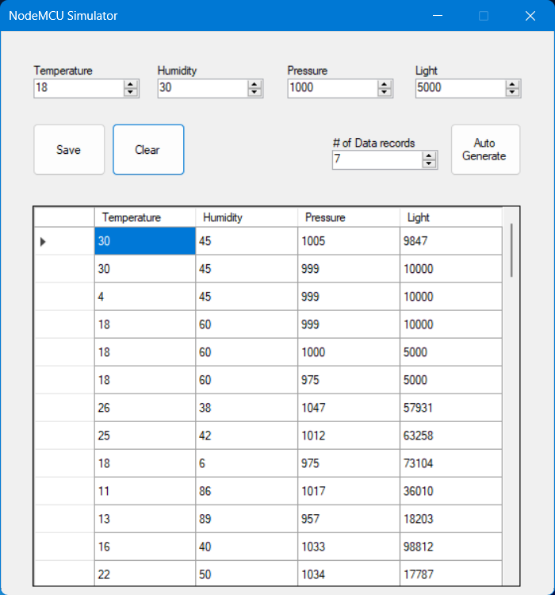
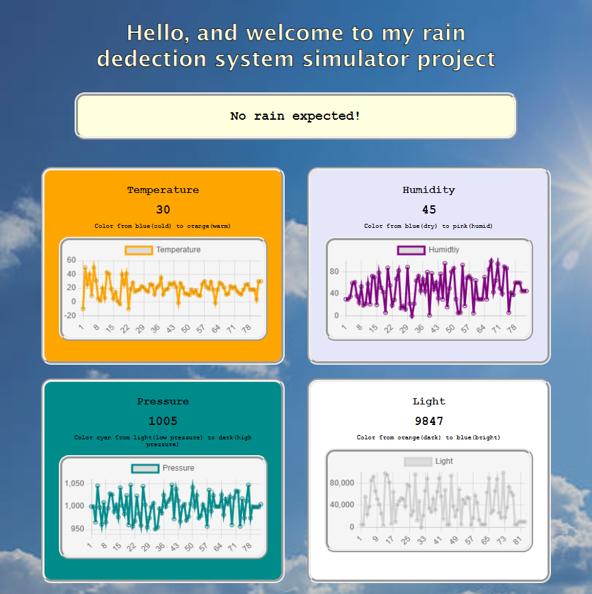
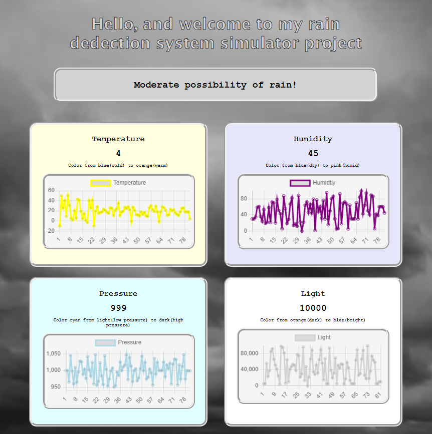
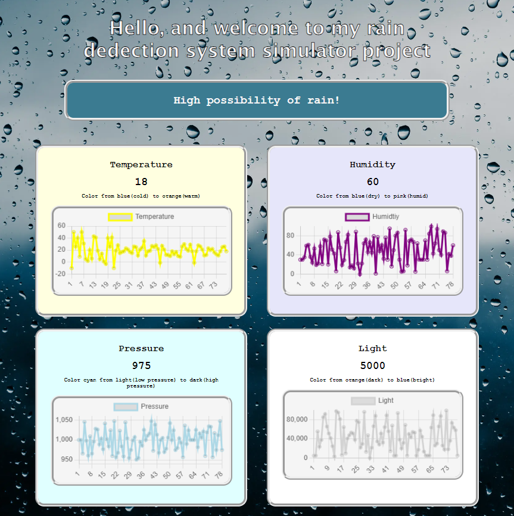

# IoT Rain Detection System Simulator

This project simulates a **NodeMCU microcontroller** reading data from connected sensors and sending it to a web application. It uses **WinForms**, **ASP.NET WebAPI**, and a basic frontend with **HTML**, **CSS**, and **JavaScript**, using **Chart.js** to generate line charts for the sensor values.

---

## Overview

* **NodeMCU Simulation**: A **C# WinForms** application simulates the behavior of a NodeMCU microcontroller. It generates sensor data that would normally be read from physical sensors.
* **Data Flow**: The simulated data is sent to a **WebAPI** (ASP.NET) that stores the readings in a database.
* **Web Visualization**: A website retrieves the latest data from the database at set intervals to simulate a continuous data flow from the NodeMCU. The frontend uses **Chart.js** to display live charts of sensor readings.

---

## Features

* Simulate sensor readings from a NodeMCU device.
* Send simulated data to a central WebAPI.
* Store sensor readings in a database.
* Display live charts of sensor values in a web interface.
* Visual changes on the website based on weather conditions (sunny, cloudy, rainy).

---

## Screenshots

### Simulator

### Website – Visualizing Data by Rain Chance

  
  
  

---

## Technology Stack

* **WinForms (C#)** – NodeMCU simulator
* **ASP.NET WebAPI** – Backend API for storing sensor data
* **Database** – Any relational database supported by WebAPI
* **HTML / CSS / JS** – Frontend
* **Chart.js** – Line chart visualization

---

## How It Works

1. **Simulator**: Generates random or predefined sensor readings.
2. **WebAPI**: Receives the sensor data and stores it in the database.
3. **Website**: Periodically fetches the latest readings and updates charts and visuals according to rain probability.

---

## Usage

* Run the WinForms simulator to start generating data.
* Ensure the WebAPI is running and connected to the database.
* Open the website in a browser to visualize real-time data.

---

This project demonstrates a full-stack **IoT simulation** with sensor data generation, API integration, and live web visualization.

